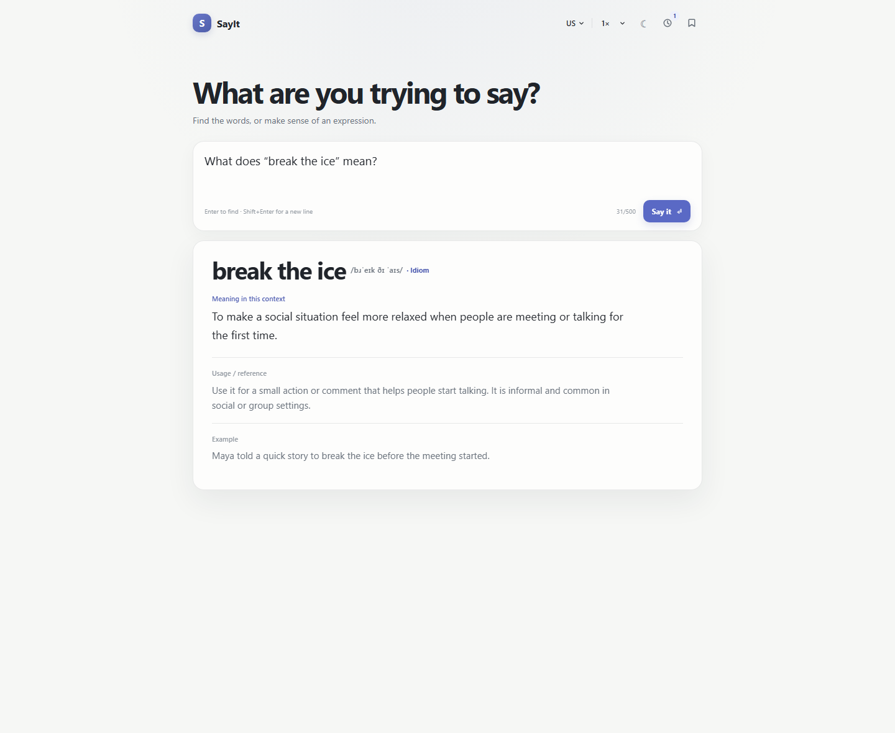
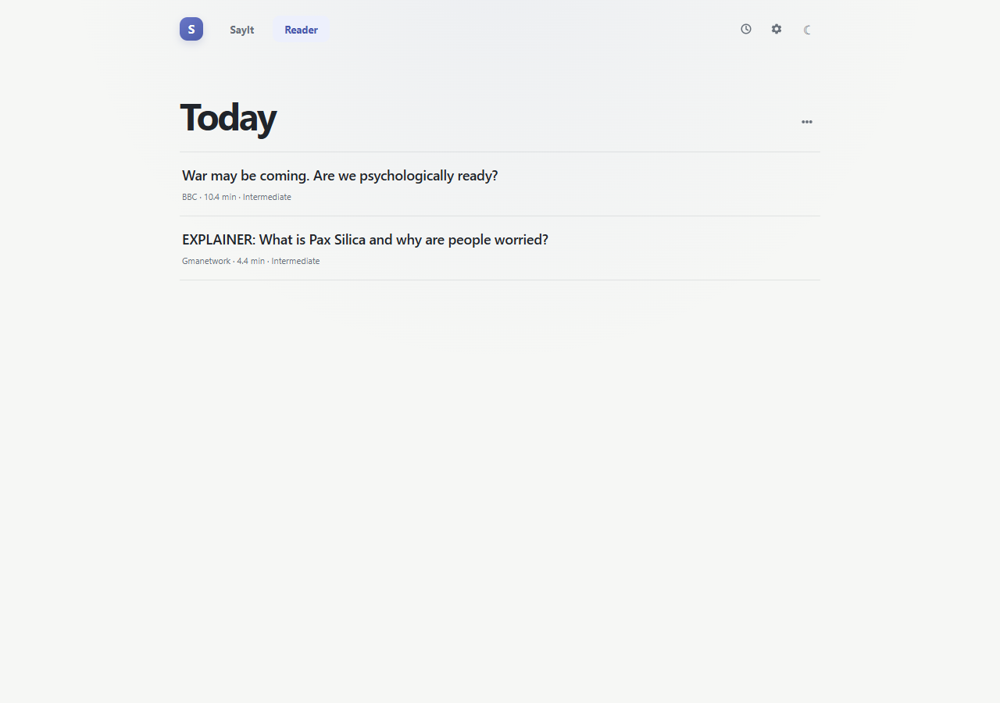

# SayIt

**Find the words you mean. Understand the English you read.**

SayIt is a local-first English companion for two everyday problems: not being able to
put a thought into words, and not fully understanding the English you are reading.
It runs on your own machine — a small React app, a local Node server, and your own
DeepSeek API key. There is no account, no telemetry, and no SayIt-hosted service.

SayIt has two modes that share one window and one history:

- **SayIt** turns a rough thought into the expression English actually uses, and
  explains an expression you select.
- **Reader** delivers a small curated set of full-text English news articles on a
  daily schedule, and lets you look up any word in them while you read.

---

## Features

**Both modes**

- One shell, two workspaces — switch without losing your place.
- A shared **History** drawer: *Expressions* records what you asked, *Reading*
  records the issues you have read and how far you got.
- Copy, save, and replay results. Nothing leaves your machine except the single
  request you explicitly trigger.
- A local result cache, so asking the same thing twice does not spend a second
  model call.

**SayIt**

- Best-match expression, alternatives, meaning in context, usage/reference notes,
  and an example sentence.
- Local IPA transcription for the expression.
- Audible playback through your browser's own voices, with a US/UK accent choice
  and normal or slow speed.

**Reader**

- A dated Daily Issue, built from your topics, article count, difficulty and
  reading budget.
- Full-text articles, not teasers: a page must declare its own article body before
  Reader will store or display it.
- Select any word or phrase while reading to get a local definition, IPA, and
  playback — or send it to SayIt for a contextual explanation.
- Reading progress is remembered per article, across restarts.
- A dated archive of previous issues, including editions you regenerate.

---

## SayIt — expression retrieval and contextual interpretation

Type roughly what you mean. SayIt returns the expression an English speaker would
reach for, rather than a literal translation of your wording:

> **you** — `sort ideas by shared traits`
> **SayIt** — *draw a parallel*, with alternatives, meaning in context, and usage notes

You can also go the other way. Select an expression — in SayIt or inside a Reader
article — and SayIt explains what it means *in that sentence*, not in the abstract.
A single word gets a local dictionary definition and IPA; a phrase gets a contextual
interpretation with the surrounding article sentence as context.

Results are cached locally, and asking twice is free. Pronunciation is played by
your browser's built-in Web Speech voices, so no audio is ever uploaded.

## Reader — curated English news and contextual word lookup

Reader builds one issue per day at a time you choose. It reads a set of official
publisher feeds (BBC, The Guardian, NPR, Al Jazeera) plus a web search fallback,
merges everything into one deduplicated candidate list, and then applies your
preferences:

| Preference | Meaning |
| --- | --- |
| Topics | Politics, Economy, Finance, Geopolitics, and others |
| Articles per day | How many articles the issue should contain |
| Difficulty | Easy, Intermediate, or Advanced, from measured reading difficulty |
| Reading budget | Total minutes the issue should aim for |
| Collection time | When the daily issue is built, in your time zone |

Every article is verified before it is delivered. Reader checks the publisher's own
identity for the page, refuses topic and index pages, adopts the publisher's
canonical URL when one is declared, requires the page to declare its article body as
full text, and rejects anything whose stated publication date does not fit the issue
being built. If the sources cannot satisfy your preferences, Reader says so and
reports the shortage instead of padding the issue with unsuitable articles.

Difficulty is an aid, not a gate. An article one tier away from your preference is
still eligible, and the closest match is chosen first; an article two tiers away is
refused. The measured difficulty is always shown as measured.

While reading, select text to get a local dictionary entry with IPA, hear it, copy
it, or send it to SayIt. Articles you are allowed to keep are cached locally and
stay readable offline; everything else stays a link.

---

## Screenshots

**SayIt — expression retrieval and contextual interpretation**



**Reader — the daily issue**



---

## Quick Start — Windows

1. Install **Node.js 24 LTS** from <https://nodejs.org/> (Node 24 or newer is
   required — see [Limitations](#limitations)).
2. Download or clone this repository.
3. Double-click **`Start SayIt.vbs`** in the project folder.

On the first run the launcher creates `.env.local` from `.env.example`, installs
dependencies if they are missing, starts the local server in a hidden window, waits
for it, and opens SayIt in your browser.

When it tells you to, open `.env.local` in Notepad, put your DeepSeek API key after
`DEEPSEEK_API_KEY=`, save the file, and double-click `Start SayIt.vbs` again.

The launcher reuses an already-running SayIt instead of starting a second one, and
does not require any PowerShell execution-policy change. Startup logs are written to
`%TEMP%\SayIt\server.log`.

## Manual installation and configuration

```powershell
npm install
Copy-Item .env.example .env.local
```

Put your key in `.env.local`:

```text
DEEPSEEK_API_KEY=your-key
DEEPSEEK_MODEL=deepseek-flash
DEEPSEEK_BASE_URL=https://api.deepseek.com
```

Then start the app:

```powershell
npm run dev
```

Open the URL Vite prints — by default <http://127.0.0.1:5173/>. Type a rough English
thought and press Enter. Use Shift+Enter for a new line.

The key is read by the local Node server only. It is never sent to the browser and
never leaves your machine except as the `Authorization` header on the DeepSeek
request you triggered yourself. `.env.local` is git-ignored.

Other commands:

```powershell
npm run typecheck   # TypeScript, no emit
npm test            # Vitest
npm run build       # type-check and production build
```

## Daily Reader collection setup

Reader's daily collection is owned by **one** scheduler: a Windows Task Scheduler
task named `SayIt Reader Collection`. It does not depend on a browser window or on
the development server staying open.

These commands use PowerShell 7 (`pwsh`), which is what SayIt is set up and tested
with. Register the task from the repository root:

```powershell
pwsh -File scripts/register-reader-task.ps1            # create or update the task
pwsh -File scripts/register-reader-task.ps1 -RunNow    # trigger one run now
pwsh -File scripts/register-reader-task.ps1 -Remove    # remove it
```

The script refuses to register the task on a Node older than 24, because the task
would otherwise fail where nobody can see it.

The task wakes every ten minutes and makes one bounded decision each time, so extra
invocations do nothing: a completed issue is left alone, a run already in progress is
never started twice, and a retry that is not due yet keeps its scheduled time. Every
run appends one line to `%LOCALAPPDATA%\SayIt\Reader\scheduler.log`, so a missed or
crashed schedule leaves evidence rather than disappearing.

A dated recovery of an earlier, unfulfilled issue is available explicitly and never
touches an issue that was already delivered:

```powershell
npx vite-node server/reader/scheduler-main.ts --backfill 2026-10-09 --json
```

## Local storage and privacy

SayIt has no hosted service and no account. The only outbound calls are the ones your
own use triggers: model requests to the DeepSeek API when you press **Say it** or a
Reader collection is due, and — during a collection only — queries to public news
search engines plus direct fetches of the publisher pages those queries return. The
search queries are derived from your saved topics, and nothing about you is sent
with them.

| What | Where it lives |
| --- | --- |
| Your API key | `.env.local`, read by the local server only |
| Preferences, History, result cache, IPA cache | Your browser's `localStorage` |
| Reader state: issues, attempts, progress, permitted article bodies | `%LOCALAPPDATA%\SayIt\Reader\reader-state.db` (SQLite, WAL mode) |
| Scheduler log | `%LOCALAPPDATA%\SayIt\Reader\scheduler.log` |
| Launcher log | `%TEMP%\SayIt\server.log` |

- No accounts, no analytics, no telemetry, no crash reporting, no third-party
  trackers.
- All API endpoints bind to loopback and refuse non-local callers.
- Article bodies are only stored when the publisher permits caching; everything else
  stays a link.
- SayIt never bypasses a paywall, a login, or a publisher's access controls, and
  never fabricates an article body.

To erase everything, delete `%LOCALAPPDATA%\SayIt`, clear the site's browser storage,
and delete `.env.local`.

## Technology stack

- **React 19** + **TypeScript** + **Vite 7** single-page app.
- **Node.js 24** local server. Reader state uses the built-in `node:sqlite` module in
  WAL mode, so every mutation is committed transactionally and two processes cannot
  overwrite each other's work.
- **Zod** contracts shared between the server and the browser.
- **jsdom** + **`@mozilla/readability`** for fetching and extracting publisher pages.
- **`phonemize`** (MIT) for local IPA; the browser's Web Speech API for audio.
- **Vitest** for tests.
- DeepSeek for expression retrieval, contextual interpretation, and editorial
  curation.

Engineering notes on the invariants behind Reader's state, scheduling, recovery, and
article supply live in [`docs/ARCHITECTURE.md`](docs/ARCHITECTURE.md).

## Limitations

- **Windows-first.** `Start SayIt.vbs` and the scheduled-task script are Windows
  only; `npm run dev` works anywhere Node 24 runs.
- **Node.js 24 or newer is required.** Reader stores its state with the built-in
  `node:sqlite` module. It only became usable without a command-line flag in Node
  22.13/23.4, and it is still marked experimental there, so SayIt targets the Node 24
  LTS baseline. `Start SayIt.vbs` and `scripts/register-reader-task.ps1` both refuse
  to run on an older Node and tell you so instead of failing silently later.
- **You need your own DeepSeek API key** and an internet connection for new
  requests. Cached answers, saved expressions, and already-read articles keep
  working offline.
- **A daily issue can come up short.** Some publishers block automated readers or
  put articles behind a paywall. Reader reports a partial or missing issue honestly
  rather than substituting lower-quality content.
- **Reading difficulty is an approximation.** It is computed from the text's own
  word, sentence, and syllable counts, and it guides selection rather than proving an
  article suitable or unsuitable.
- **IPA is a learner hint, not a pronunciation authority.** It comes from the local
  `phonemize` engine, which combines letter-to-sound rules with its own bundled
  exception lexicon, so proper nouns and ambiguous words can be off. Source
  punctuation and accented letters are folded before transcription, and where no
  usable transcription is produced the IPA line is simply hidden.
- **English only**, and web search fallback depends on a third-party engine that can
  rate-limit.
- **Article text belongs to its publisher** and is shown for your personal reading
  only.

## Contributing

Issues and pull requests are welcome.

```powershell
npm install
npm run typecheck
npm test
npm run build
```

Please keep the existing behavior contracts in mind: Reader state must stay
transactional, exactly one component may own the schedule, articles may only be
delivered after full-text verification, and pronunciation, History, and the shared
result cache are shared behavior across both modes. `docs/ARCHITECTURE.md` describes
the invariants worth preserving.

## Third-party acknowledgments

SayIt's own code is MIT. It builds on other people's work under their own licenses,
including Princeton WordNet (WordNet License), `wordfreq` (CC BY-SA 4.0 data),
`phonemize` (MIT), `@mozilla/readability` (Apache-2.0), React, Zod, jsdom, and Vite.
Article headlines and text belong to their publishers; SayIt is not affiliated with
or endorsed by them.

Full attribution, license texts, and the reasoning behind the pronunciation engine
choice are in [`THIRD-PARTY-NOTICES.md`](THIRD-PARTY-NOTICES.md).

## MIT License

Copyright (c) 2026 ZY-Dragon03.

Released under the [MIT License](LICENSE). Third-party components and datasets keep
their own licenses, as recorded in [`THIRD-PARTY-NOTICES.md`](THIRD-PARTY-NOTICES.md).
